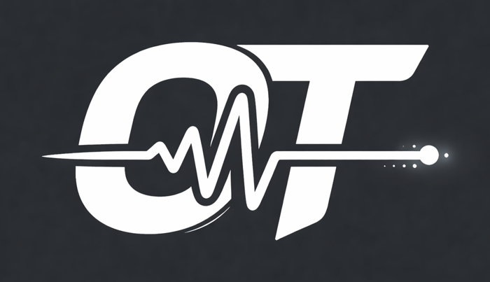
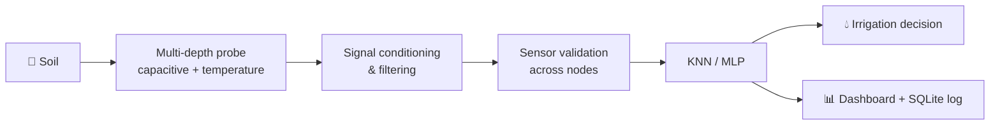

# Ahmed Oukali

**Embedded Systems & Environmental Sensing Engineer**

 

  

---

## 👋 About Me

I'm **Ahmed**, an Embedded Systems & Electronics Engineer. I build systems where the **physical world meets software**: custom sensors, low-level firmware, signal processing, and AI that turns raw measurements into decisions.

| | |
|:--|:--|
| 🎓 **Education** | M.Sc. Embedded Systems Engineering, Université Ibn Khaldoun de Tiaret (2024–2025), ranked 1st in Electronics |
| 🔭 **Focus** | Environmental sensing · Edge AI · Precision agriculture |
| 🌍 **Languages** | Arabic (native) · English · French |

> **Electronics → Sensors → Firmware → Acquisition → Signal Processing → AI/ML → Decision Support → Dashboard → Automation**

---

## 🌱 Featured Project

### Real-Time Monitoring and Autonomous Smart Irrigation Based on Soil Moisture Profiling

Irrigation shouldn't depend on a single surface value. This project builds a **vertical soil profile** so decisions reflect the **root zone**.

| Capability | Details |
|:--|:--|
| 🧪 **Custom probe** | Helical capacitive moisture electrodes with temperature sensing at several depths |
| 📉 **Signal conditioning** | TLV272-based analog stage, temperature-assisted interpretation |
| 🧠 **AI** | KNN and MLP, tested on black, red and brown soils over ~2 months |
| 🕸️ **Local network** | Nodes cross-check neighbors to flag abnormal or failed sensors, no cloud dependency |
| 🗺️ **Roadmap** | PIC → STM32 nodes with nRF links → Raspberry Pi hub with dashboard, AI and camera |

> Roadmap items are planned, not deployed.

### 🔌 Hardware

<table>
  <tr>
    <td align="center"> Board layout, 3D view</td>
    <td align="center"> Microcontroller board, 3D view</td>
  </tr>
</table>

---

## 🛠️ Other Projects

| Project | What it does | Stack | Links |
|:--|:--|:--|:--|
| 💡 **Smart Lighting Control** | AI-based remote lighting control with energy optimization | ESP32 · TensorFlow · WiFi/BLE · MQTT · React Native | [Code](https://github.com/ahmedoukali-pixel/lighting-control) |
| 🤖 **Autonomous Robot with AI Vision** | Object detection and navigation | ESP32 · TensorFlow Lite · OpenCV | [Code](https://github.com/ahmedoukali-pixel/autonomous-robot) |
| 🔌 **Multi-Layer PCB Design** | Signal-integrity and thermal optimization | Altium Designer | See hardware above |

**Web projects:** [MAZE GARDEN](https://hostinghosting144-star.github.io/MAZE_GARDEN./) (HTML5 · CSS3 · JavaScript) · Personal Portfolio

---

## ⚡ Tech Stack

| | |
|:--|:--|
| 🔧 **Embedded** | C · C++ · PIC16F/18F · dsPIC33 · STM32 · ESP32 · Arduino · Raspberry Pi · FreeRTOS · Embedded Linux |
| 🔌 **Hardware** | Altium Designer · KiCad · Proteus · Ngspice · Analog conditioning · Multi-layer PCB · DSP |
| 🧠 **AI & Vision** | KNN · MLP · TensorFlow · TensorFlow Lite · OpenCV · Edge AI · Python · MATLAB |
| 🎨 **Web** | HTML5 · CSS3 · JavaScript · React Native |
| 🗄️ **Data** | SQL · SQLite · MQTT · Local dashboards |
| 🏭 **Industrial & Tools** | PLC · HMI · SCADA · Git · MPLAB X · Keil µVision |

---

## 💼 Experience

| Role | Organization | Focus |
|:--|:--|:--|
| **Industrial Automation** (current) | Tassyir Digital | PLC · HMI · SCADA |
| **AI Intern** | SIINE Academy | AI projects, software development, web solutions |

---

## 🏆 Competitions & Certificates

<b>Competitions</b>

 

| Event | Date | Notes |
|:--|:--|:--|
| Chipathon 2026, Track B: Circuits for Sensors | 2026 | Participant · OpenLane · Sky130 · Magic · Ngspice |
| INV-TECH Hackathon | Mar 2025 | 5G and IoT solutions |
| Drone Innovation Challenge | Sep 2024 | Autonomous drone systems for agriculture and delivery |
| NOVATECH Hackathon | Nov 2023 | **Finalist** |

<b>Certificates</b>

 

- Advanced Embedded Systems Design
- Computer Vision for Robotics
- IoT System Architecture
- RTOS Programming (FreeRTOS)
- Advanced PCB Design

---

## 🤝 Let's Build Something

Open to collaboration on embedded systems, environmental sensing, Edge AI and smart agriculture.

  

<i>"Innovating the future, one circuit at a time"</i>

