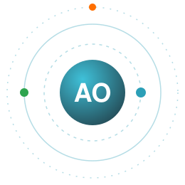
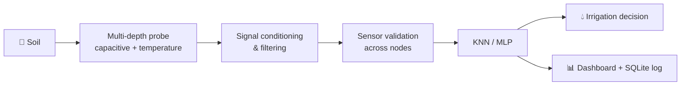
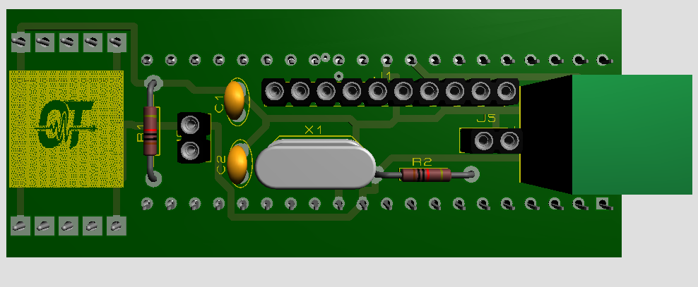
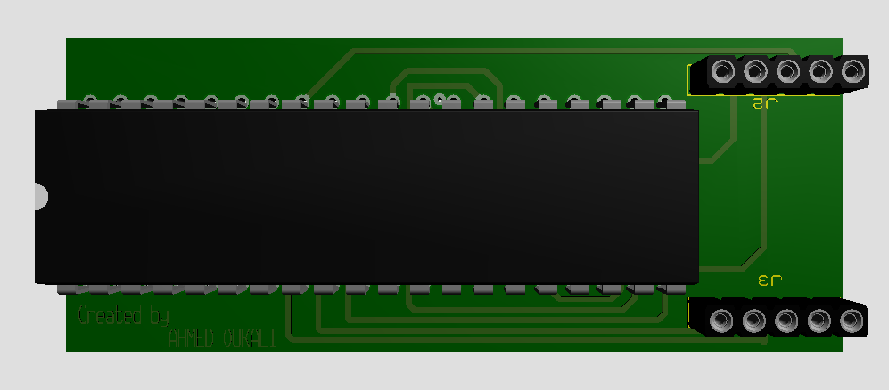
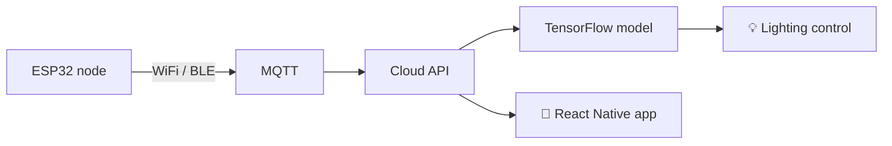
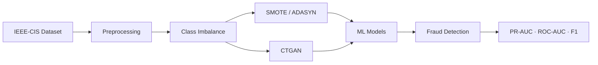

<!-- ===================== HEADER ===================== -->

 

  

 

<!-- ===================== ABOUT ===================== -->
## 👋 About Me

I'm **Ahmed**, an **Embedded Systems & Electronics Engineer** with an **M.Sc. in Embedded Systems Engineering** from **Ibn Khaldoun University of Tiaret, Algeria**.

I build systems where **the physical world meets software**: custom sensors, low-level firmware, signal processing, and AI that turns raw measurements into decisions, plus the databases and dashboards that make that data usable.

| | |
|:--|:--|
| 🎓 **Education** | M.Sc. Embedded Systems Engineering, Université Ibn Khaldoun de Tiaret (2024–2025), ranked 1st in Electronics |
| 💼 **Now** | Industrial automation (PLC / HMI / SCADA) at **Tassyir Digital** |
| 🧠 **Previously** | AI Intern at **SIINE Academy** |
| 🔭 **Focus** | Environmental sensing · Edge AI · Precision agriculture · Digital twins |
| 🌍 **Languages** | Arabic (native) · English · French |

 

<!-- ===================== WHAT I DO ===================== -->
## 🧭 What I Do

| 🔌 Sense | ⚙️ Process | 🧠 Decide |
|:--|:--|:--|
| Custom sensor probes | Low-level firmware (C / C++) | KNN and MLP models |
| Analog signal conditioning | Filtering and signal processing | Edge AI and on-device inference |
| Multi-layer PCB design | SQL / SQLite logging | Irrigation and lighting control |
| Proteus 8.17 · Ngspice simulation | MQTT and wireless links | Dashboards and PLC / SCADA automation |

<!-- ===================== FEATURED ===================== -->
## 🌱 Featured Project

### Real-Time Monitoring and Autonomous Smart Irrigation Based on Soil Moisture Profiling

An **IoT + Edge AI agricultural system** that builds a **vertical soil profile**, so irrigation decisions reflect the **root zone** instead of a single surface value.

| Capability | Details |
|:--|:--|
| 🧪 **Custom probe** | Helical capacitive moisture electrodes with temperature sensing at several depths |
| 📉 **Signal conditioning** | TLV272-based analog stage, temperature-assisted interpretation |
| 🧠 **Intelligence** | KNN and MLP, tested on black, red and brown soils over ~2 months |
| 🕸️ **Local network** | Nodes cross-check neighbors to flag abnormal or failed sensors, no cloud dependency |
| 🗄️ **Data logging** | SQL / SQLite storage of readings and decisions |
| 📊 **Visualization** | Dashboard with the soil profile (roadmap: Raspberry Pi hub) |
| 🌍 **Impact** | Designed for water optimization in semi-arid agriculture |

<b>🏗️ System architecture, layer by layer</b>

 

| Layer | Role | Technologies |
|:--|:--|:--|
| **1. Sensing** | Capacitive moisture and temperature at multiple depths | Custom helical electrodes |
| **2. Conditioning** | Amplification, filtering, temperature compensation | TLV272 · Proteus 8.17 · Ngspice |
| **3. Node firmware** | Acquisition, calibration, packet handling | C · PIC (current) → STM32 (roadmap) |
| **4. Validation** | Neighbor cross-check to detect failed or abnormal sensors | Local network logic |
| **5. Intelligence** | Soil-state classification and irrigation decision | KNN · MLP · Python |
| **6. Hub & interface** | Storage, dashboard, optional camera | SQLite · Raspberry Pi · nRF24L01 · WebSocket / FastAPI |

> Roadmap items (STM32 nodes, nRF links, Raspberry Pi hub with dashboard, AI and camera) are planned, not deployed.

<table>
  <tr>
    <td align="center"> Board layout, 3D view</td>
    <td align="center"> Microcontroller board, 3D view</td>
  </tr>
</table>

<!-- ===================== SECOND PROJECT ===================== -->
## 💡 Embedded AI Project

### Smart Lighting Control System

AI-based **remote lighting control** with energy optimization, from ESP32 firmware to a mobile app.

- 📡 Connectivity over **WiFi / BLE** and **MQTT**
- 🧠 **TensorFlow** model for energy optimization
- 📱 Mobile control through a **React Native** app
- 🔗 [Source code](https://github.com/ahmedoukali-pixel/lighting-control)

<!-- ===================== RESEARCH ===================== -->
## 💳 AI Research Project

### Enhancing Fraud Detection Through Synthetic Tabular Data Augmentation

Improving **financial fraud detection** with synthetic data generation and machine learning on the **IEEE-CIS Fraud Detection** dataset.

- ⚖️ Severe class imbalance analysis
- 🔄 Oversampling with **SMOTE** and **ADASYN**
- 🧬 Synthetic tabular generation with **CTGAN**
- 📊 Evaluation with **PR-AUC, ROC-AUC, Precision, Recall, F1**
- 🔬 Comparative study of augmentation strategies

> Academic / team work. My contribution: _fill in your part here_.

<!-- ===================== PROJECTS ===================== -->
## 🛠️ Projects

### 🔧 Embedded & Hardware

| Project | What it does | Stack | Links |
|:--|:--|:--|:--|
| 🌱 **Soil Moisture Profiling** | Multi-depth soil sensing and autonomous irrigation | Custom probe · TLV272 · PIC · KNN · MLP · SQLite | [GitHub](https://github.com/ahmedoukali-pixel) |
| 💡 **Smart Lighting Control** | AI-based remote lighting control with energy optimization | ESP32 · TensorFlow · WiFi/BLE · MQTT · React Native | [Code](https://github.com/ahmedoukali-pixel/lighting-control) |
| 🤖 **Autonomous Robot with AI Vision** | Object detection and navigation | ESP32 · TensorFlow Lite · OpenCV | [Code](https://github.com/ahmedoukali-pixel/autonomous-robot) |
| 🔌 **Multi-Layer PCB Design** | Signal-integrity and thermal optimization | Altium Designer · Proteus 8.17 | See hardware images above |

### 🌐 Software, Data & Team Projects

| Project | What it does | Stack | Links |
|:--|:--|:--|:--|
| 🌾 **AgriTwin** | Real-time agricultural monitoring and intelligent irrigation (team project) | Raspberry Pi · NRF24L01 · FastAPI · WebSocket · AI | [Repository](https://github.com/hostinghosting144-star) |
| 🗺️ **Digital Twin for Agricultural Monitoring** | Digital twin of a monitored agricultural site | IoT data · simulation | Academic work |
| 📦 **E-commerce Warehouse Simulation** | Warehouse management simulation | AnyLogic | Academic work |
| 💳 **Fraud Detection** | Fraud classification with synthetic tabular data augmentation | Python · XGBoost · Random Forest · SMOTE · CTGAN | [Repository](https://github.com/hostinghosting144-star) |
| 🎓 **Wonder School** | Online education and school management platform | Vue 3 · Vite · Tailwind · FastAPI · PostgreSQL | [Repository](https://github.com/hostinghosting144-star) |
| 🧠 **Recommendation System** | Personalized recommendations via collaborative filtering | Java · JavaFX · Cosine Similarity | [Repository](https://github.com/hostinghosting144-star) |
| 🎮 **MAZE GARDEN** | Interactive web platform for games and puzzles | HTML5 · CSS3 · JavaScript | [Live](https://hostinghosting144-star.github.io/MAZE_GARDEN./) · [Source](https://github.com/hostinghosting144-star/MAZE_GARDEN) |
| 🌐 **Portfolio** | Animated, responsive portfolio site (dark theme, scroll animations) | HTML5 · CSS3 · JavaScript | [Live](https://hostinghosting144-star.github.io/Portfolio/) |

<!-- ===================== TECH STACK ===================== -->
## ⚡ Tech Stack

**🔧 Embedded Systems** 
 
PIC16F/18F · dsPIC33 · STM32 · ESP32 · FreeRTOS · MPLAB X · Keil µVision

  

**🔌 Hardware, Simulation & Signal** 

 
Analog signal conditioning · Multi-layer PCB · DSP · Circuit simulation

  

**🧠 AI & Vision** 
 
KNN · MLP · TensorFlow Lite · Edge AI · On-device inference

  

**🗄️ Data & Databases** 
 
SQL (queries, schema design, joins) · SQLite · MQTT · WebSocket · Local dashboards

  

**🎨 Web & Mobile** 
 
Responsive design · CSS animations · Intersection Observer · React Native

  

**📝 Research & Documentation** 
 
 
Scientific writing, reports and papers in LaTeX

  

**🏭 Industrial & Tools** 
 
PLC · HMI · SCADA

<!-- ===================== EXPERIENCE ===================== -->
## 🏆 Experience

| Role | Organization | Period |
|:--|:--|:--|
| 🏭 **Industrial Automation (PLC / HMI / SCADA)** | Tassyir Digital | Apr 2026 – Present |
| 🤖 **Artificial Intelligence Intern** | SIINE Academy | Jan 2026 – Apr 2026 |

<b>📚 Research & Academic Work</b>

 

- Real-Time Monitoring and Autonomous Smart Irrigation Based on Soil Moisture Profiling
- Fraud Detection Through Synthetic Tabular Data Augmentation
- Digital Twin for Agricultural Monitoring
- E-commerce Warehouse Management Simulation (AnyLogic)
- Machine Learning & Data Science projects
- Web & mobile application development

<b>🏅 Competitions</b>

 

| Event | Date | Notes |
|:--|:--|:--|
| Chipathon 2026, Track B: Circuits for Sensors | 2026 | Participant · OpenLane · Sky130 · Magic · Ngspice |
| INV-TECH Hackathon | Mar 2025 | 5G and IoT solutions |
| Drone Innovation Challenge | Sep 2024 | Autonomous drone systems for agriculture and delivery |
| NOVATECH Hackathon | Nov 2023 | **Finalist** |

<b>📜 Certificates</b>

 

- Advanced Embedded Systems Design
- Computer Vision for Robotics
- IoT System Architecture
- RTOS Programming (FreeRTOS)
- Advanced PCB Design

<!-- ===================== ROADMAP ===================== -->
## 🚀 What I'm Working On

| Status | Item |
|:--|:--|
| 🔬 **Active** | Soil moisture profiling: validation across soils and sensor-failure detection |
| 🧪 **Next** | Migrating nodes from PIC to STM32 with nRF links |
| 🖥️ **Next** | Raspberry Pi hub: dashboard, AI inference and camera |
| 🎯 **2026** | Chipathon 2026, Track B: analog circuits for sensors (Sky130) |

<!-- ===================== STATS ===================== -->
## 📊 GitHub Analytics

<picture>
  <source media="(prefers-color-scheme: dark)" srcset="https://raw.githubusercontent.com/ahmedoukali-pixel/ahmedoukali-pixel/output/github-snake-dark.svg"/>
  
</picture>

<!-- ===================== AREAS ===================== -->
## 🎯 Areas of Interest

<!-- ===================== CONTACT ===================== -->
## 🤝 Let's Build Something

Open to collaboration on **embedded systems, environmental sensing, Edge AI, smart agriculture, digital twins** and technical web platforms.

  

